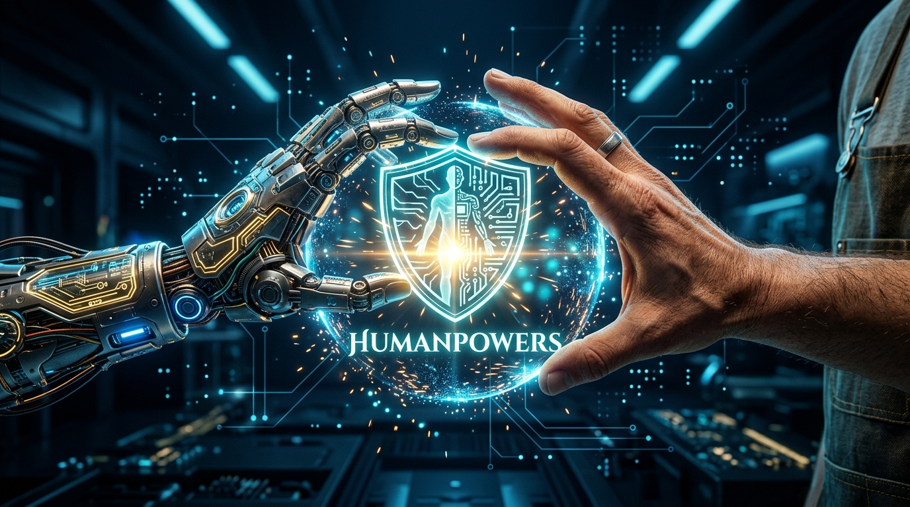

<p align="center">
  
</p>

# 🛡️ Humanpowers: Autonomous AI Agent Craftsmanship & Work Ethic Protocol

> **Humanpowers** — An open-source protocol and modular framework that injects human-like responsibility, professional craftsmanship, and autonomous self-inspection into AI coding agents. Permanently kills prompt babysitting.

[](LICENSE)
[](AGENTS.md)
[](#-supported-ai-agent-ecosystems)
[](AGENTS.md)

---

## 🎯 The Pain Point: "Prompt Babysitting"
Developers and knowledge workers waste 40+ minutes every day micromanaging AI agents:
- Base models rush to generate raw boilerplate, leaving lazy `// TODO` stubs, uncaught edge cases, and security vulnerabilities.
- Users are trapped in a frustrating back-and-forth prompt loop: *"Fix this error, you broke that import, handle this edge case."*
- **Humanpowers ends this loop.** It wraps the agent in an autonomous reflection pipeline: the agent embodies an elite veteran persona, audits its own draft against rigorous checklists, auto-repairs flaws, and delivers 100% production-ready work.

---

## ⚡ Core Capabilities & Built-in Tooling:

1. **🧠 Project Memory & Scar Tissue Ledger (`.humanpowers/memory.json`):**
   Maintains persistent memory of team conventions, user preferences, and past anti-patterns. The agent never repeats the same mistake twice.
2. **🔌 Official Model Context Protocol (MCP) Server (`mcp/server.py`):**
   Full MCP standard server allowing Claude, Cursor, and Antigravity to programmatically trigger code audits, retrieve persona heuristics, and query memory.
3. **🚀 GitHub Actions CI/CD Quality Gate (`ci/humanpowers-gate.yml`):**
   Automated pull request and push inspection that fails builds if unfinished stubs or security risks are committed.
4. **👁️ Real-Time Watchdog Daemon (`scripts/watchdog.py`):**
   Live background watcher that flags amateur AI habits (lazy TODOs, silent catches, exposed API keys) the moment files are saved.
5. **🛡️ Git Pre-Commit Gatekeeper (`scripts/pre-commit-gatekeeper.py`):**
   Stops low-quality or vulnerable commits at the gate before code reaches version control.
6. **🎭 Persona Forge (`cli/persona_forge.py`):**
   Instantly generate and register custom domain personas with rigorous 5-point checklists in 1 command.
7. **📊 Time-Saved & ROI Tracker (`scripts/roi_tracker.py`):**
   Calculates exact engineering hours and babysitting cycles saved by the Humanpowers protocol.
8. **🖥️ Interactive Terminal HUD (`cli/dashboard.py`):**
   Real-time terminal dashboard displaying protocol status, agent readiness, and active heuristics.

---

## 📁 Supported AI Agent Ecosystems:

Humanpowers is decoupled and packaged into standalone, plug-and-play directories for all 11 major AI agent environments:

| # | Agent Environment | Target Platform | Core Config Files |
| :- | :--- | :--- | :--- |
| 1 | 🤖 [`antigravity-agent/`](./antigravity-agent/) | **Google Antigravity & Gemini CLI** | `.agents/plugins/`, `AGENTS.md`, `skills/` |
| 2 | 🧠 [`claude-code-agent/`](./claude-code-agent/) | **Anthropic Claude Code CLI** | `CLAUDE.md`, `skills/` |
| 3 | ⚡ [`cursor-agent/`](./cursor-agent/) | **Cursor AI Code Editor** | `.cursorrules`, `.cursor/rules/*.mdc`, `skills/` |
| 4 | 🐙 [`copilot-agent/`](./copilot-agent/) | **GitHub Copilot (CLI & Workspace)** | `.github/copilot-instructions.md`, `skills/` |
| 5 | 🌊 [`windsurf-agent/`](./windsurf-agent/) | **Windsurf IDE (Cascade AI)** | `.windsurfrules`, `skills/` |
| 6 | 🏛️ [`hermes-agent/`](./hermes-agent/) | **Nous Research Hermes Agent OS** | `HERMES.md`, `system_prompt.txt`, `skills/` |
| 7 | 💻 [`codex-agent/`](./codex-agent/) | **OpenAI Codex CLI** | `CODEX.md`, `.codex/config.json`, `skills/` |
| 8 | 🥧 [`pie-agent/`](./pie-agent/) | **Pi / Pie Coding Agent CLI (Rust)** | `PIE.md`, `.pie/config.json`, `skills/` |
| 9 | 🖥️ [`opencode-agent/`](./opencode-agent/) | **OpenCode Terminal TUI Agent** | `OPENCODE.md`, `.opencode/agent.json`, `skills/` |
| 10| 🦅 [`openclaw-agent/`](./openclaw-agent/) | **OpenClaw Autonomous Agent Platform** | `OPENCLAW.md`, `.openclaw/agent_manifest.json`, `skills/` |
| 11| 🐍 [`universal-python-agent/`](./universal-python-agent/) | **Python, LangChain, AutoGen, CrewAI** | `craftsman/` SDK, `example.py`, `skills/` |

---

## 🛠️ Quick Commands:

```bash
# 1. Launch the Humanpowers Terminal HUD:
python cli/dashboard.py

# 2. Check protocol status via Node.js CLI:
node bin/humanpowers.js status

# 3. Create a new custom professional persona:
python cli/persona_forge.py --create "Crypto Security Auditor"

# 4. Run pre-commit code audit:
python scripts/pre-commit-gatekeeper.py

# 5. View ROI & Time-Saved Report:
python scripts/roi_tracker.py

# 6. Start the Model Context Protocol (MCP) Server:
python mcp/server.py
```

---

## 🏛️ The Council of Masters (Adversarial Reflection):
Whenever an agent executes a complex prompt, it runs an internal tri-party review:
* **The Creator:** Architects the optimal, modern, clean solution.
* **The Red Teamer (Devil's Advocate):** Relentlessly probes for edge cases, race conditions, and vulnerabilities.
* **The Principal Master:** Synthesizes the debate into a single, bulletproof, verified artifact.

---

## 📄 License
MIT License. Created with human craftsmanship for the global AI community.
