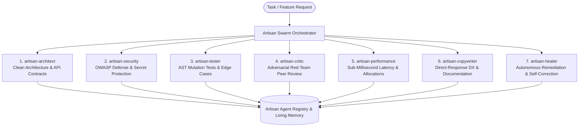

<p align="center">
  
</p>

# 🛡️ Artisan: Autonomous Quality Protocol & Pre-Commit Craftsmanship Gate

> **Deterministic pre-commit AST gatekeeper, cross-agent continuity memory, and multi-agent coordination protocol for modern AI coding workflows.**

[](https://github.com/kapitan00000978-sketch/artisan/actions)
[](https://www.npmjs.com/)
[](mcp/server.py)
[](LICENSE)

---

### ⚡ Quick Start (3 Commands)

```bash
# 1. Initialize pre-commit gate & agent rules in your repo
npx github:kapitan00000978-sketch/artisan init

# 2. Audit staged git changes for stubs, secrets & empty catches
artisan audit --staged

# 3. Autonomously fix detected silent catches & placeholder stubs
artisan fix
```

<p align="center">
  
</p>

### 💡 Instant Example: What Artisan Intercepts

```python
# ❌ Standard AI Output (Blocked by Pre-Commit Gate)
def handle_webhook(payload):
    try:
        token = "sk_live_93847291834729183472"      # Secret leak!
        process_event(payload)
    except Exception:
        pass                                        # Silent error suppression!
    # Unfinished placeholder stub                   # Incomplete logic!

# ✅ After Artisan Auto-Fix (`artisan fix`)
import os
import logging

logger = logging.getLogger(__name__)

def handle_webhook(payload):
    token = os.environ.get("WEBHOOK_SECRET_KEY")
    if not token:
        raise ValueError("WEBHOOK_SECRET_KEY environment variable required")
    try:
        process_event(payload)
    except Exception as exc:
        logger.error("Failed to process webhook payload: %s", exc, exc_info=True)
        raise
```

---

## ⚡ The Fundamental Shift: Standard AI vs. Artisan

| Dimension | Standard AI Coding (Unmanaged) | With Artisan Protocol (v2.0) |
| :--- | :--- | :--- |
| **Code Completeness** | ❌ Leaves lazy placeholders (`pass`, unfinished stubs) | ✅ **Pre-Commit AST Gate**: Blocks unhandled stubs at pre-commit |
| **Error Handling** | ❌ Silently swallows errors (`except: pass`, empty `catch {}`) | ✅ **Self-Healing Engine**: Auto-refactors to structured logging |
| **Session Memory** | ❌ Total amnesia — forgets yesterday's bugs and decisions | ✅ **Living Memory Fabric**: `.artisan/memory.json` retains historical scar tissue |
| **Cross-Agent Continuity** | ❌ Claude Code, Cursor, and Copilot start from zero each session | ✅ **Continuity Handoff**: `artisan resume` & `artisan checkpoint` (optional) |
| **Token Efficiency** | ❌ ~12,000+ token monolithic prompt dump | ✅ **Smart Context Engine**: ~6x context optimization (~2K targeted tokens) |
| **Verification Rigor** | ❌ Untested code committed directly into branches | ✅ **Automated Gate**: Pre-commit validation against configurable quality scores |

---

## 📊 Synthetic Verification Suite (`bench/`)

Artisan provides a reproducible verification harness evaluating deterministic static detection and autonomous remediation across 10 controlled fixtures containing common AI anti-patterns (`python bench/run_benchmark.py`):

| Fixture Metric | Baseline (no gate) | With Artisan (Gatekeeper + Auto-Fix) |
| :--- | :--- | :--- |
| **Quality Gate Pass Rate** | `1 / 10` (10.0%) | **`10 / 10` (100.0%)** |
| **Defects Neutralized** | `0` (flaws leak into codebase) | **`9` anti-patterns deterministically resolved** |
| **Remediation Cycles** | Unbounded / Manual human triage | **Average `1.0` cycle auto-remediation** |

> Controlled evaluation methodology and task fixtures: [`bench/BENCHMARK_REPORT.md`](./bench/BENCHMARK_REPORT.md).  
> *Note: Artisan's own protocol and CLI codebase is verified across 550+ automated unit, regression, and mutation tests.*

---

## 🤖 7 Autonomous Sub-Agents (`artisan swarm`)

Rather than overloading a single model context with contradictory instructions, Artisan v2.0 coordinates 7 specialized autonomous sub-agents with dedicated roles:



| Sub-Agent | Core Lead | Focus Area |
| :--- | :--- | :--- |
| **`artisan-architect`** | Marcus Sterling | Clean architecture, modular decomposition, clean APIs, zero tech-debt. |
| **`artisan-security`** | Gabriel Frost | Zero-trust threat modeling, OWASP Top 10 defense, credential protection. |
| **`artisan-critic`** | Red-Team Auditor | Objective adversarial peer review, defect ledger compilation, veto/approval. |
| **`artisan-tester`** | Quality & Mutation Lead | AST mutation testing, boundary coverage, fuzzing, regression catch validation. |
| **`artisan-performance`** | Valerie Cross | Mechanical sympathy, CPU cache alignment, zero hot-loop allocations, sub-ms latency. |
| **`artisan-copywriter`** | Diana Drake | High-impact READMEs, clear API references, developer experience. |
| **`artisan-healer`** | Autonomous Remediator | AST-level auto-repair of silent catches, missing handlers, and unfinished stubs. |

---

## 🏛️ The Council of Masters (Core Engineering Leads)

Artisan incorporates battle-tested heuristic checklists inspired by senior engineering disciplines. For standard software development, Artisan focuses on **8 Core Engineering Leads**:

| # | Master | Discipline & Role | Core Focus |
| :- | :--- | :--- | :--- |
| 1 | 💻 **Marcus 'The Vanguard' Sterling** | Senior Software Architect | SOLID principles, modular decomposition, clean APIs, zero stubs |
| 2 | 🛡️ **Gabriel 'The Sentinel' Frost** | Principal Cybersecurity Auditor | OWASP Top 10 defense, parameterization, secret protection |
| 3 | ⚙️ **Valerie 'The Edge' Cross** | Systems Performance Architect | Cache alignment, zero hot-loop allocations, sub-millisecond budgets |
| 4 | 🎯 **Diana 'The Closer' Drake** | Direct-Response Copy & DX | Clear documentation, unambiguous API specs, zero AI filler |
| 5 | 🎨 **Elena 'The Visionary' Rostova** | UI/UX Systems Architect | WCAG 2.1 AAA accessibility, 8pt design token grid, responsive layout |
| 6 | ⚡ **Gareth 'The Unbreakable' Drake** | Cloud SRE & DevOps Architect | Idempotent IaC, resilient container builds, health probes, zero downtime |
| 7 | 🔬 **Dr. Evelyn 'The Oracle' Reed** | Data Science & ML Systems | Data leakage prevention, statistical validation, deterministic schemas |
| 8 | ⚖️ **Arthur 'The Ironclad' Pendelton** | Commercial Counsel & Contracts | Licensing compliance, liability boundaries, clear interfaces |

> 📖 **Specialized & Scientific Masters:** The complete 64-master roster (covering deep-tech simulation, cryogenics, quantum optics, and astrodynamics) is documented in [`docs/COUNCIL.md`](./docs/COUNCIL.md).  
> When querying via `artisan context` or MCP, `SmartMasterSelector` dynamically injects only the 2–3 relevant engineering leads, achieving **~6x context optimization (~2K targeted tokens vs ~12K full rubric dump)**.

---

## 📦 Universal Production Libraries (`src/libraries/`)

Artisan v2.0 ships zero-dependency, production-grade enterprise building blocks ready for immediate use via `artisan lib <domain>`:

| Domain Module | Path | Description |
| :--- | :--- | :--- |
| **Auth & Security** | [`src/libraries/auth_security.py`](./src/libraries/auth_security.py) | PBKDF2/HMAC-SHA256 password hashing, constant-time verification, cryptographic token generation, and role-based permissions. |
| **Database Engine** | [`src/libraries/database.py`](./src/libraries/database.py) | Parameterized SQLite connection pooling, automatic schema migrations, and transaction management with zero raw string interpolation. |
| **Payments & Billing** | [`src/libraries/payments.py`](./src/libraries/payments.py) | Idempotent payment intent processing, double-charge defense, webhook signature verification, and audit logs. |
| **Real-Time PubSub** | [`src/libraries/real_time.py`](./src/libraries/real_time.py) | In-memory pub/sub broker with regex topic matching, backpressure buffering, and thread-safe delivery. |
| **Caching Layer** | [`src/libraries/caching.py`](./src/libraries/caching.py) | Thread-safe LRU/TTL cache with expiration sweeps, cache-stampede locking, and cache-aside decorators. |
| **Resilient HTTP Client** | [`src/libraries/resilient_http.py`](./src/libraries/resilient_http.py) | Standard-library HTTP client with exponential backoff, jitter, circuit breaker state machine, and timeouts. |

---

## 🧠 Cross-Agent Continuity Memory (`artisan resume`)

AI coding sessions frequently suffer from amnesia when switching between tools (e.g. running Claude Code in terminal and Cursor in IDE).

Artisan provides **Cross-Agent Continuity**:
- **Automatic Checkpointing (`artisan checkpoint`):** Records current task, active files, pending verification steps, and blocker warnings to `.artisan/continuity.json`.
- **Seamless Resume (`artisan resume`):** Allows any agent to pick up exactly where the last one left off without asking repetitive questions.
- **Strictly Optional:** Teams that prefer ephemeral sessions can disable continuity anytime via `artisan resume --no-continuity` or configuring `continuity.enabled: false`.

---

## 🔌 Model Context Protocol (MCP 2.0 Server)

Artisan exposes its full inspection, memory, and library suite as standard JSON-RPC 2.0 tools for Claude Desktop, Claude Code, Cursor, Windsurf, and Antigravity:

```bash
# Start MCP server over stdio:
artisan mcp
# or: python mcp/server.py
```

### Exposed MCP Tools:
- `artisan_select_masters` — Context-aware selection of relevant domain leads based on task keywords.
- `artisan_inject_prompt` — Generates a task-targeted 2K-token dynamic prompt (~6x context optimization).
- `artisan_inspect_code` — Pre-commit AST-level flaw and secret leak analysis on code strings.
- `artisan_get_lessons` — Searches past scar tissue and mistakes to prevent repeating bugs.
- `artisan_record_learning` — Autonomously writes lessons and success patterns into persistent storage.
- `artisan_resume_continuity` — Retrieves cross-agent continuity state and checkpoints.
- `artisan_save_checkpoint` — Saves agent task progress and blockers across sessions.
- `artisan_get_library` — Retrieves production-grade implementation modules (`auth`, `db`, `payments`, etc.).
- `artisan_review_code` — Runs adversarial red-team code review on diffs or source code.
- `artisan_get_persona` — Retrieves full discipline criteria and pledge for any Council Master.
- `artisan_list_council` — Lists the Council roster.
- `artisan_recall_memory` — Direct query interface for memory ledger.

---

## 🌐 3D Spatial Swarm HUD (`artisan 3d`)

Artisan includes an interactive WebGL 3D HUD that visualizes active multi-agent swarms, lock states, memory clusters, and audit health in real time:

```bash
artisan 3d
```
Opens `http://localhost:3000` with interactive camera controls, agent swarm nodes, and live health metrics.

---

## 📁 Supported AI Agent Ecosystems

Artisan configures 14 agent environments with native instructions and rule sets:

| # | Agent Environment | Target Platform | Core Config Files |
| :- | :--- | :--- | :--- |
| 1 | 🤖 [`antigravity-agent/`](./antigravity-agent/) | **Google Antigravity & Gemini CLI** | `.agents/plugins/`, `AGENTS.md`, `skills/` |
| 2 | 🧠 [`claude-code-agent/`](./claude-code-agent/) | **Anthropic Claude Code CLI** | `CLAUDE.md`, `skills/` |
| 3 | ⚡ [`cursor-agent/`](./cursor-agent/) | **Cursor AI Code Editor** | `.cursorrules`, `.cursor/rules/*.mdc`, `skills/` |
| 4 | 🐙 [`copilot-agent/`](./copilot-agent/) | **GitHub Copilot (CLI & Workspace)** | `.github/copilot-instructions.md`, `skills/` |
| 5 | 🌊 [`windsurf-agent/`](./windsurf-agent/) | **Windsurf IDE (Cascade AI)** | `.windsurfrules`, `skills/` |
| 6 | 🛠️ [`cline-agent/`](./cline-agent/) | **Cline & Roo Code (VS Code Extension)** | `.clinerules`, `skills/`, `mcp/server.py` |
| 7 | 🌙 [`kimi-agent/`](./kimi-agent/) | **Moonshot Kimi Code Agent** | `KIMI.md`, `skills/`, `mcp/server.py` |
| 8 | ⚡ [`kilo-agent/`](./kilo-agent/) | **Kilo Code Agent** | `KILO.md`, `skills/`, `mcp/server.py` |
| 9 | 🏛️ [`hermes-agent/`](./hermes-agent/) | **Nous Research Hermes Agent OS** | `HERMES.md`, `system_prompt.txt`, `skills/` |
| 10| 💻 [`codex-agent/`](./codex-agent/) | **OpenAI Codex CLI** | `CODEX.md`, `.codex/config.json`, `skills/` |
| 11| 🥧 [`pie-agent/`](./pie-agent/) | **Pi / Pie Coding Agent CLI (Rust)** | `PIE.md`, `.pie/config.json`, `skills/` |
| 12| 🖥️ [`opencode-agent/`](./opencode-agent/) | **OpenCode Terminal TUI Agent** | `OPENCODE.md`, `.opencode/agent.json`, `skills/` |
| 13| 🦅 [`openclaw-agent/`](./openclaw-agent/) | **OpenClaw Autonomous Agent Platform** | `OPENCLAW.md`, `.openclaw/agent_manifest.json`, `skills/` |
| 14| 🐍 [`universal-python-agent/`](./universal-python-agent/) | **Python, LangChain, AutoGen, CrewAI** | `craftsman/` SDK, `example.py`, `skills/` |

---

## 🚀 Reusable GitHub Action (`@v2` / `@v1`)

Audit Pull Requests and Pushes automatically in your CI workflow (`.github/workflows/artisan.yml`):

```yaml
name: Artisan Quality Gate
on: [push, pull_request]

jobs:
  audit:
    runs-on: ubuntu-latest
    steps:
      - uses: actions/checkout@v4
      - name: Run Artisan Quality & Security Gate
        uses: kapitan00000978-sketch/artisan@v2
```
*(Both `@v2` and `@v1` tags are actively maintained and resolve to current stable releases).*

---

## ⚙️ Configuration (`artisan.config.json`)

Customize score thresholds and selectively toggle rules in your repository root:

```json
{
  "threshold_score": 100,
  "rules": {
    "STUB_TODO_FIXME": { "enabled": true, "severity": "error" },
    "STUB_EMPTY_CATCH": { "enabled": true, "severity": "error" },
    "STUB_BARE_EXCEPT": { "enabled": true, "severity": "error" },
    "DANGEROUS_EVAL_EXEC": { "enabled": true, "severity": "error" }
  },
  "exclude_dirs": [".git", "node_modules", "tests", "bench"],
  "exclude_files": ["detector.py"]
}
```

---

## 💻 Complete CLI Command Reference

```bash
# ⚡ Initialization & Setup
artisan init                 # Auto-detects stack, installs pre-commit hook & agent configs
artisan doctor               # Diagnostic check on git hooks, MCP, and agent rules

# 🛡️ Quality Audit & Auto-Fix
artisan audit                # Audits entire repository for stubs, secrets & bad patterns
artisan audit --staged       # Fast audit on git-staged changes only
artisan fix                  # Autonomously repairs silent catches and unfinished stubs

# 🎯 Context & Memory
artisan context "<task>"     # Generates targeted 2K-token prompt (~6x context optimization)
artisan memory               # Inspects living persistent memory and recorded scar tissue
artisan memory --search "jwt" # Search historical lessons by keyword

# 🤖 Swarm & Multi-Agent Coordination
artisan swarm "<task>"       # Dispatches task across autonomous sub-agent swarm
artisan swarm "<task>" --plan # Previews multi-agent decomposition plan
artisan agents               # Displays active agent concurrency and file locks

# 🔄 Cross-Agent Continuity
artisan resume               # Resumes from last agent checkpoint
artisan checkpoint "<msg>"   # Checkpoints active progress and blockers
artisan resume --no-continuity # Disables continuity tracking

# 📦 Enterprise Libraries
artisan lib auth             # Inspects and exports production auth & security library
artisan lib db               # Inspects database connection pool & migration library
artisan lib payments         # Inspects idempotent payment processing library
artisan lib list             # Lists all available domain libraries

# ⚔️ Adversarial Review & Mutation Testing
artisan review --staged      # Runs red-team adversarial code review on staged changes
artisan mutate <file> --test <test_file>  # Zero-dependency AST mutation testing

# 🌐 3D HUD & Protocol Server
artisan 3d                   # Launches real-time 3D WebGL Swarm & Memory HUD
artisan hud                  # Terminal dashboard HUD
artisan mcp                  # Launches Model Context Protocol JSON-RPC 2.0 server
artisan metrics              # Prints workspace quality score and file statistics
```

---

## 🔍 How It Works & Limitations

- **Pre-Commit Defense:** The gatekeeper (`scripts/pre-commit-gatekeeper.py`) inspects staged source files and AST nodes before git commits are finalized.
- **Deterministic Scope:** The gatekeeper deterministically detects unfinished stubs, bare exception catches (`except: pass`, empty `catch {}`), dangerous dynamic code execution, and hardcoded secrets. It does not replace application-specific business logic tests.
- **Continuity Scope:** Checkpoints track files, status, and notes in `.artisan/continuity.json`. It is fully local and does not transmit code to external servers.

---

## 📄 License
MIT License. Open source under the MIT License.
