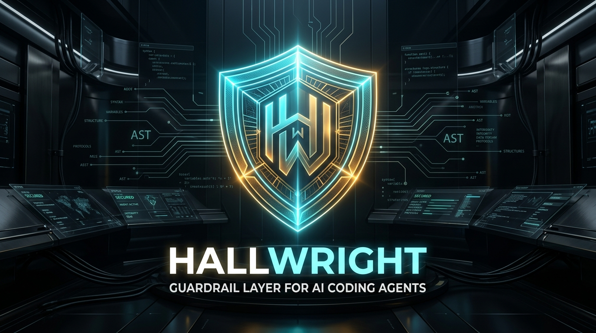

<p align="center">
  
</p>

# 🛡️ Artisan: Autonomous AI Agent Craftsmanship & Quality Protocol

> **Artisan** is an open-source engineering discipline and quality protocol for AI coding assistants. It enforces deterministic pre-commit & CI gates against unfinished stubs and leaked secrets, injects role-based expert personas, maintains persistent project memory across sessions, and exposes standard Model Context Protocol (MCP) tooling for Claude Code, Cursor, Copilot, Windsurf, Antigravity, and other modern agents.

[](LICENSE)
[](https://kapitan00000978-sketch.github.io/artisan/)
[](AGENTS.md)
[](#-the-council-of-masters-character-roster)
[](#-supported-ai-agent-ecosystems)
[](AGENTS.md)

<p align="center">
  
</p>

---

## 🌐 Live Interactive Playground

Experience real-time static code auditing, AST-based flaw detection, and autonomous remediation directly in your browser:  
👉 **[Open Live Playground](https://kapitan00000978-sketch.github.io/artisan/)**

---

## 📊 Empirik Isbot: Benchmark Natijalari (`bench/`)

Artisan shunchaki tavsiyalar to‘plami emas — u o‘lchanadigan natijalar beradi. 10 ta real kod generatsiyasi vazifasi bo‘yicha o‘tkazilgan mustaqil benchmark (`python bench/run_benchmark.py`):

| Ko‘rsatkich | Boshlang‘ich AI (Artisan’siz) | Artisan bilan (Gatekeeper + Auto-Fix) |
| :--- | :--- | :--- |
| **Sifat Gatekeeperidan o‘tish** | `1 / 10` (10.0%) | **`10 / 10` (100.0%)** |
| **Bartaraf etilgan nuqsonlar** | `0` (xatolar repoga o‘tib ketadi) | **`9` ta nuqson avtomatik to‘g‘rilandi** |
| **Tuzatish tsikllari (Cycles)** | Noma'lum / Inson aralashuvi | **O‘rtacha `1.0` tsiklda avto-tuzatish** |

> Batafsil hisobot va barcha 10 ta vazifa kodlari: [`bench/BENCHMARK_REPORT.md`](./bench/BENCHMARK_REPORT.md)

---

## ⚖️ Qachon kerak va qachon kerak emas? (Decision Matrix)

| Holat | Artisan kerakmi? | Sababi |
| :--- | :---: | :--- |
| **Production yoki Jamoaviy repolar** | ✅ **HA** | Chala `TODO`lar, yashirin `except: pass` va sizib chiqqan API kalitlar repoga kirmaydi. |
| **AI agentlar bilan kod yozish** | ✅ **HA** | Claude Code, Cursor, Cline va Kimi'ga qat'iy intizom yuklaydi, vaqtni tejaydi. |
| **CI/CD pipeline va Pre-commit** | ✅ **HA** | Barcha PR'lar uchun yagona xolis sifat darvozasini o‘rnatadi. |
| **5 daqiqalik bir martalik prototip** | ❌ *Kerak emas* | Agar shunchaki tezda bitta fikrni sinab ko‘rmoqchi bo‘lsangiz, qat'iy gatekeeper xalaqit qilishi mumkin. |
| **Faqat matn/kontent yozish** | ❌ *Kerak emas* | Loyihada dasturlash kodlari bo‘lmasa, kod tekshiruvi talab etilmaydi. |

---

## 📌 Loyiha Tasnifi (Project Description)

**Artisan nima?**  
Artisan — bu dasturchi va AI coding agentlari (Claude Code, Cursor, Copilot, Windsurf, Antigravity va boshqalar) o‘rtasidagi sifat ko‘prigi. Standart AI modellar tez va ko‘p kod yozadi, biroq ularda doimiy intizom yo‘q: kod ichida chala `TODO`lar, bo‘sh `except: pass` bloklari, xavfli `eval()` chaqiriqlari yoki tasodifan qoldirib ketilgan API kalitlar paydo bo‘ladi. 

Artisan bu muammoni 5 ta ustun orqali hal qiladi:
1. **🛡️ Mustaqil Pre-Commit & CI Filtrlari (`scripts/detector.py`):** Kod git repoga kiritilishidan oldin har bir faylni statik tahlil qiladi va Python AST (Abstract Syntax Tree) orqali chuqur semantik tekshiruv o‘tkazadi. Maxfiy kalitlar (`sk-...`, `ghp_...`, `AKIA...`), xavfli buyruqlar va chala stubs topilsa, commit qat'iy to‘xtatiladi.
2. **🔧 Avtomatik Tuzatish Dvigateli (`artisan fix` / `scripts/remediator.py`):** Bo‘sh `except: pass` va `catch {}` xatolarini mustaqil ravishda to‘g‘ri logging va xatoliklar boshqaruviga o‘tkazadi.
3. **🏛️ The Council of Masters (Senior Heuristics):** AI agentiga arxitektura, xavfsizlik, SRE, ML, UI/UX, 3D, fizika, mobil, brend, audio, ma'lumotlar bazasi, SEO va AI agentik tizimlar bo‘yicha 16 nafar Senior darajadagi mutaxassis tajribasi va mezonlarini kontekst sifatida yuklaydi.
4. **🧠 Doimiy Loyiha Xotirasi (`.artisan/memory.json`):** Loyihaning arxitekturaviy qoidalari va o‘tmishdagi xatolarini saqlab qoladi, shunda AI agent bir xil xatoni qayta takrorlamaydi.
5. **🔌 Model Context Protocol (MCP) Serveri (`mcp/server.py`):** Standart JSON-RPC 2.0 orqali AI muhitlariga kod tahlili va rollarni to‘g‘ridan-to‘g‘ri vosita (tool) sifatida taqdim etadi.

---

## 🎯 The Problem: Iterative Prompt Micromanagement
Developers often spend significant time micromanaging AI coding assistants:
- Base models may rush to generate boilerplate, occasionally leaving unfinished `TODO` stubs, unhandled boundary conditions, or unparameterized queries.
- Users frequently enter an iterative correction loop: *"Fix this error, you broke that import, handle this edge case."*
- **Artisan addresses this:** By embedding structured domain rules and automated quality checks directly into agent configuration files, the assistant self-audits before presenting results.

---

## 🔍 How It Works & Limitations

- **Session-Based Rules:** Rules files (`AGENTS.md`, `CLAUDE.md`, `.cursorrules`, etc.) load per agent session into your assistant's system instructions.
- **Local Tooling:** The file sentinel watchdog (`scripts/watchdog.py`) and pre-commit gatekeeper (`scripts/pre-commit-gatekeeper.py`) are local command-line tools that run on your machine and in CI.
- **Limitations:** The gate catches the listed patterns (stubs, dangerous eval/exec, hardcoded secrets), not all bugs.
- **Demo Simulation Module:** The web engine in `src/engine/craftsmanshipEngine.js` is a non-functional, client-side interactive DEMO simulation for UI previewing; production enforcement is carried out by `scripts/detector.py` and the MCP server.

---

## 🏛️ The Council of Masters (Domain Heuristics):

Artisan packages role-specific heuristics inspired by senior discipline leads:

| # | Master | Discipline & Role | Archetype | Core Focus |
| :- | :--- | :--- | :--- | :--- |
| 1 | 💻 **Marcus 'The Vanguard' Sterling** | Senior Software Architect & Systems Lead | Systems Sovereign & Zero-Tech-Debt Purist | SOLID architecture, zero unhandled stubs, concurrency |
| 2 | 🎯 **Diana 'The Closer' Drake** | Direct-Response Conversion Copywriter | Neuromarketing Alchemist & Persuasion Virtuoso | High-clarity hooks, value proposition, zero AI filler |
| 3 | 🎨 **Elena 'The Visionary' Rostova** | Principal UI/UX Designer & Systems Architect | Aesthetic Sovereign & Spatial Ergonomics Master | WCAG 2.1 AAA accessibility, 8pt spatial grid, design tokens |
| 4 | 📊 **Victor 'The Fortress' Montgomery** | Startup Financial Strategist & Fractional CFO | Unit-Economics Inquisitor & Capital Defense | Unit economics, burn rate, cash conversion cycles |
| 5 | ⚖️ **Arthur 'The Ironclad' Pendelton** | Senior Commercial Counsel & Contract Auditor | Commercial Safeguard & Contractual Litigator | Contract auditing, liability containment, clear definitions |
| 6 | 🔬 **Dr. Evelyn 'The Oracle' Reed** | Staff Data Scientist & ML Systems Architect | Empirical Scientist & ML Ops Gatekeeper | Data leakage prevention, statistical validation, model drift |
| 7 | 🛡️ **Gabriel 'The Sentinel' Frost** | Principal Cybersecurity & Offensive Auditor | Zero-Trust Inquisitor & Threat Modeling | OWASP Top 10, credential protection, parameterized queries |
| 8 | ⚡ **Gareth 'The Unbreakable' Drake** | DevOps & Cloud Site Reliability Architect | Chaos Engineering Commander & Reliability | Idempotent IaC, container best practices, health probes |
| 9 | 💎 **Kaelen 'The Shaper' Vane** | Principal 3D & Spatial CGI Artist | Spatial Shaper & PBR Master | Energy-conserving PBR shaders, quad topology, WebGL |
| 10 | 🎮 **Ronan 'The Engine' Blackwood** | Lead Game Systems & Physics Architect | Engine Virtuoso & Physics Pioneer | Fixed timestep integration, continuous collision, zero GC |
| 11 | 📱 **Lucas 'The Kinetic' Cruz** | Principal Mobile Systems Architect | Kinetic Craftsman & Gesture Lead | 120Hz ProMotion budget, 48dp touch targets, spring physics |
| 12 | ✨ **Aria 'The Luminary' Solano** | Global Brand Director & Visual Master | Visual Identity & Emotional Resonance | 60-30-10 color rule, modular type scales, vector viewBox |
| 13 | 🔊 **Damian 'The Resonant' Vance** | Principal Interactive Audio & Sound Architect | Soundscape Virtuoso & Audio Lead | Click-free exponential ramps, master dynamics limiter, ADSR |
| 14 | 🗄️ **Cassandra 'The Core' Thorne** | Principal Database & Distributed Data Architect | Data Sovereign & Low-Latency Lead | Sub-10ms query plans, zero N+1 loops, concurrent DDL |
| 15 | 🌐 **Zane 'The Vector' Sterling** | Technical SEO & Growth Engineering Lead | Algorithmic Vector & Discovery Lead | Core Web Vitals (CLS=0), single H1 hierarchy, Schema.org |
| 16 | 🧠 **Naomi 'The Neural' Chen** | Principal AI Agentic & LLM Architect | Autonomous Orchestration Sovereign | Deterministic JSON schemas, prompt injection shields, circuit breaker loops |
| 17 | ⚙️ **Valerie 'The Edge' Cross** | Principal Systems & Low-Level Performance Architect | Mechanical Sympathy & Low-Latency Sovereign | 64-byte cache alignment, zero heap allocs in hot loops, zero-copy slices, SIMD |
| 18 | 🌐 **Soren 'The Conductor' Lindqvist** | Principal Distributed Consensus & Protocol Architect | Distributed Consensus & Protocol Sovereign | Strict majority quorum ((N/2)+1), term fencing, re-entrancy locks (CEI), determinism |

---

## ⚡ Core Capabilities & Built-in Tooling:

1. **🧠 Project Memory Ledger (`.artisan/memory.json`):**
   Maintains a structured record of team conventions, user preferences, and recorded anti-patterns to avoid repeating known mistakes.
2. **🔌 Model Context Protocol (MCP) Server (`mcp/server.py`):**
   Standard JSON-RPC 2.0 MCP server allowing Claude, Cursor, and other MCP clients to query domain personas and run static code inspections.
3. **🚀 GitHub Actions CI/CD Quality Gate (`.github/workflows/artisan-gate.yml`):**
   Automated pull request and push inspection that verifies test suites and checks for lazy stubs or exposed credentials.
4. **🎨 Artisan Studio — Visual Self-Critique & World-Class Elevation (`scripts/artisan_studio.py` / `cli/studio.py`):**
   Headless Chromium visual capture (Playwright), DOM inspection, and ruthless multi-specialist critique:
   - **Elena Rostova:** UI/UX depth, liquid-glass cards, typography, and micro-interactions.
   - **Diana Drake:** Eliminates generic AI cliches, injects high-voltage magnetic copy.
   - **Marcus Sterling & Gabriel Frost:** Semantic mobile responsiveness and security checks.
   - **Autonomous Elevation (`--elevate`):** Automatically upgrades beginner mockups into award-winning, responsive, liquid-glass web experiences with visual before-and-after proof.

5. **👁️ Real-Time Watchdog Daemon (`scripts/watchdog.py`):**
   Continuous background file sentinel (`--watch`) that monitors local edits and flags stubs, empty catches, and credential leaks.
6. **🛡️ Git Pre-Commit Gatekeeper (`scripts/pre-commit-gatekeeper.py`):**
   Pre-commit hook stopping unfinished stubs, silent exception suppressions, or plaintext keys before git commits.
7. **🎭 Persona Forge (`cli/persona_forge.py`):**
   CLI to create and register custom domain checklists and personas.
8. **📊 Workspace Quality & Audit Report (`scripts/roi_tracker.py`):**
   Inspects and reports real workspace metrics: active files, total lines audited, and gatekeeper compliance.
8. **🖥️ Interactive Terminal HUD (`cli/dashboard.py`):**
   Terminal dashboard displaying active protocol status, Council roster, and heuristic checklists.

---

## 📁 Supported AI Agent Ecosystems:

Artisan provides tailored configuration modules across 14 agent environments:

| # | Agent Environment | Target Platform | Core Config Files |
| :- | :--- | :--- | :--- |
| 1 | 🤖 [`antigravity-agent/`](./antigravity-agent/) | **Google Antigravity & Gemini CLI** | `.agents/plugins/`, `AGENTS.md`, `skills/` |
| 2 | 🧠 [`claude-code-agent/`](./claude-code-agent/) | **Anthropic Claude Code CLI** | `CLAUDE.md`, `skills/` |
| 3 | ⚡ [`cursor-agent/`](./cursor-agent/) | **Cursor AI Code Editor** | `.cursorrules`, `.cursor/rules/*.mdc`, `skills/` |
| 4 | 🐙 [`copilot-agent/`](./copilot-agent/) | **GitHub Copilot (CLI & Workspace)** | `.github/copilot-instructions.md`, `skills/` |
| 5 | 🌊 [`windsurf-agent/`](./windsurf-agent/) | **Windsurf IDE (Cascade AI)** | `.windsurfrules`, `skills/` |
| 6 | 🛠️ [`cline-agent/`](./cline-agent/) | **Cline & Roo Code (VS Code Extension)** | `.clinerules`, `skills/`, `mcp/server.py` |
| 7 | 🌙 [`kimi-agent/`](./kimi-agent/) | **Moonshot Kimi Code Agent** | `KIMI.md`, `skills/`, `mcp/server.py` |
| 8 | ⚡ [`kilo-agent/`](./kilo-agent/) | **Kilo Code Agent** | `KILO.md`, `skills/`, `mcp/server.py` |
| 9 | 🏛️ [`hermes-agent/`](./hermes-agent/) | **Nous Research Hermes Agent OS** | `HERMES.md`, `system_prompt.txt`, `skills/` |
| 10| 💻 [`codex-agent/`](./codex-agent/) | **OpenAI Codex CLI** | `CODEX.md`, `.codex/config.json`, `skills/` |
| 11| 🥧 [`pie-agent/`](./pie-agent/) | **Pi / Pie Coding Agent CLI (Rust)** | `PIE.md`, `.pie/config.json`, `skills/` |
| 12| 🖥️ [`opencode-agent/`](./opencode-agent/) | **OpenCode Terminal TUI Agent** | `OPENCODE.md`, `.opencode/agent.json`, `skills/` |
| 13| 🦅 [`openclaw-agent/`](./openclaw-agent/) | **OpenClaw Autonomous Agent Platform** | `OPENCLAW.md`, `.openclaw/agent_manifest.json`, `skills/` |
| 14| 🐍 [`universal-python-agent/`](./universal-python-agent/) | **Python, LangChain, AutoGen, CrewAI** | `craftsman/` SDK, `example.py`, `skills/` |

---

## ⚡ Quick Installation:

Install Artisan configuration files into any repository:

```bash
# 🍏 Linux & macOS (curl bash installer):
curl -fsSL https://raw.githubusercontent.com/kapitan00000978-sketch/artisan/main/install.sh | bash

# 🪟 Windows PowerShell (1-line installer):
irm https://raw.githubusercontent.com/kapitan00000978-sketch/artisan/main/install.ps1 | iex

# 📦 Node.js / npx (directly from GitHub repo):
npx github:kapitan00000978-sketch/artisan init

# 🐍 Universal Python CLI:
python cli/installer.py --agent all
```

---

## 🚀 Reusable GitHub Action (`@v1`)

O‘z repoyingizdagi barcha Pull Request va Push'larni sifat darvozasi orqali avtomatik tekshirish uchun workflow faylingizga (`.github/workflows/artisan.yml`) 3 qator qo‘shish kifoya:

```yaml
name: Artisan Quality Gate
on: [push, pull_request]

jobs:
  audit:
    runs-on: ubuntu-latest
    steps:
      - uses: actions/checkout@v4
      - name: Run Artisan Quality & Security Gate
        uses: kapitan00000978-sketch/artisan@v1
```

---

## ⚙️ Moslashuvchan Sozlamalar (`artisan.config.json`)

Har bir jamoa qoidalarni o‘z talablariga moslab sozlashi mumkin. Repozitoriy ildizidagi `artisan.config.json`:

```json
{
  "threshold_score": 100,
  "rules": {
    "STUB_TODO_FIXME": { "enabled": true, "severity": "error" },
    "STUB_EMPTY_CATCH": { "enabled": true, "severity": "error" },
    "STUB_BARE_EXCEPT": { "enabled": true, "severity": "error" },
    "DANGEROUS_EVAL_EXEC": { "enabled": true, "severity": "error" }
  },
  "exclude_dirs": [".git", "node_modules", "tests", "bench"],
  "exclude_files": ["detector.py"]
}
```

---

## 🤝 Ochiq Kod va Hamjamiyat (Contributing)

Artisan ochiq kodli hamjamiyat uchun yaratilgan. Hissa qo‘shish uchun:
- Qo‘llanma: [`CONTRIBUTING.md`](./CONTRIBUTING.md)
- Boshlovchilar uchun vazifalar: [Good First Issues](https://github.com/kapitan00000978-sketch/artisan/labels/good%20first%20issue)


---

## 🛠️ Developer Commands:

```bash
# 1. Run the Automated Test Suite:
pytest tests/

# 2. Run the Pre-Commit Quality & Security Gatekeeper:
python scripts/pre-commit-gatekeeper.py

# 3. Launch the Continuous Watchdog Sentinel Daemon:
python scripts/watchdog.py --watch

# 4. View Workspace Quality & Metrics Report:
python scripts/roi_tracker.py

# 5. Launch the Terminal HUD:
python cli/dashboard.py

# 6. Start the Model Context Protocol (MCP) Server:
python mcp/server.py

# 7. Install Automatic Git Pre-Commit Hook:
python scripts/install_git_hook.py
```

### 💻 Artisan CLI (`npx artisan`):

```bash
# Install protocol rules into current repository
npx github:kapitan00000978-sketch/artisan init

# Automatically install Git pre-commit quality gate hook
npx github:kapitan00000978-sketch/artisan hook

# Autonomously repair silent catches and error suppression
npx github:kapitan00000978-sketch/artisan fix

# Verify configuration and environment health
npx github:kapitan00000978-sketch/artisan doctor

# Run fast audit on staged changes
npx github:kapitan00000978-sketch/artisan audit --staged

# Launch the Model Context Protocol (MCP) server
npx github:kapitan00000978-sketch/artisan mcp
```

---

## 📄 License
MIT License. Created for the global developer community.
