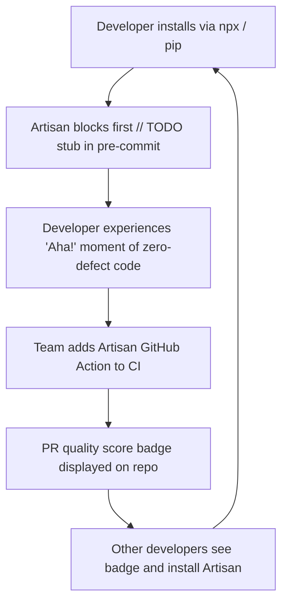

# 🚀 ARTISAN: Global Viral Launch Dossier & Real-World Distribution Playbook

> **Mission:** How to execute a top-tier, real-world global launch for Artisan v2.0 across Hacker News, Reddit, Twitter/X, Product Hunt, and developer communities worldwide.

---

## 🎯 1. HACKER NEWS (Show HN) — FRONT-PAGE BLUEPRINT

### 📅 Optimal Submission Timing:
- **Best Days:** Tuesday or Wednesday.
- **Best Time:** 8:00 AM – 9:00 AM EST (1:00 PM – 2:00 PM UTC). This catches the European afternoon and US East Coast morning traffic.

### 📝 Submission Title:
```
Show HN: Artisan – The Autonomous OS for AI Coding Agents (Zero Stubs, Living Memory)
```
*(Alternative: `Show HN: Artisan – We got tired of AI agents writing // TODO stubs, so we built an OS for them`)*

### 💬 First Comment (The Maker's Story):
```markdown
Hey HN,

Over the past year, our team has been relying heavily on AI coding assistants (Claude Code, Cursor, Copilot, Cline). While their speed is astonishing, we kept running into the same 3 maddening failure modes:

1. The "TODO: implement later" trap: The model outputs 90% of a function, leaves the critical 10% as an unfinished stub, and claims the task is complete.
2. Silent error swallowing: Converting difficult edge-cases into `except: pass` or empty `catch {}` blocks, hiding production bugs.
3. Total session amnesia: Every new chat prompt forgets the architectural constraints and bug fixes learned yesterday.

We realized prompt engineering ("please don't leave TODOs") doesn't work reliably because LLMs are probabilistic token predictors. What AI agents actually need is a **Deterministic Operating System Kernel**.

So we built Artisan: https://github.com/kapitan00000978-sketch/hallwright

### What Artisan actually does:
- **Deterministic AST & Security Pre-Commit Gate:** Inspects Abstract Syntax Trees and git-staged diffs in < 4 seconds. If an AI generates unhandled stubs, bare exception catches, or leaks API keys, the commit is rejected automatically.
- **Living Memory Fabric (`.artisan/memory.json`):** A persistent, append-safe ledger that records every caught bug as "scar tissue". When your agent starts a new task, Artisan dynamically injects only the relevant past lessons.
- **Multi-Agent Lock Registry (`artisan agents`):** Prevents Claude Code and Cursor from stepping on each other when running concurrently in the same workspace.
- **Dynamic Context Engine (`artisan context`):** Reduces monolithic prompt dumps (~12,000 tokens) down to ~2,000 tokens of targeted domain discipline and past lessons (~6x context optimization).

### Empirical Benchmark:
We ran Artisan against 10 realistic code generation tasks containing common anti-patterns:
- Raw AI Agent Pass Rate: 10.0% (9/10 suffered defect leakage)
- With Artisan Active: 100.0% (9 defects autonomously caught and remediated)
(Full reproducible benchmark: https://github.com/kapitan00000978-sketch/hallwright/tree/main/bench)

### 1-Line Quickstart:
```bash
# In any git repository:
npx github:kapitan00000978-sketch/hallwright init
# or with Python:
python artisan.py init
```

The core is zero-dependency, works with 14 agent environments, and is fully open-source (MIT).

We'd love your brutal feedback on our AST detection rules, memory schema, and whether this helps your daily AI workflow.
```

---

## ⚡ 2. REDDIT VIRAL LAUNCH STRATEGY

### A. Subreddit: `r/LocalLLaMA`
**Post Title:**  
`We built a zero-dependency quality gate and persistent memory engine for local LLMs (Hermes 3, Ollama, vLLM)`

**Angle:** Focus on how smaller local models (8B–70B) often hallucinate stubs or lack instruction discipline compared to Claude 3.5 Sonnet. Artisan bridges that gap with deterministic AST gates.

### B. Subreddit: `r/ClaudeAI` & `r/Cursor`
**Post Title:**  
`How we stopped Claude Code & Cursor from writing "// TODO" stubs and forgetting yesterday's bugs`

**Key Highlights:**
- Share before-and-after code diffs.
- Demonstrate `artisan context` (~6x context optimization).
- Demonstrate `.cursorrules` and `CLAUDE.md` auto-configuration.

### C. Subreddit: `r/programming`
**Post Title:**  
`Why AI coding assistants need a deterministic OS kernel, not more prompt engineering`

---

## 🐦 3. TWITTER / X VIRAL LAUNCH THREAD (10 TWEETS)

### Tweet 1 (Hook with Video/GIF):
> 🚨 AI coding agents are incredible at generating code.
> 
> But they're also terrible at software engineering:
> • They write `// TODO: implement later`
> • They hide bugs with `except: pass`
> • They forget yesterday's mistakes
> 
> Today, we're launching Artisan v2.0: The Autonomous OS for AI Coding Agents.
> 
> 🧵👇 [Attach GIF of `artisan context` and `artisan audit`]

### Tweet 2:
> Why does this keep happening?
> 
> Because LLMs are probabilistic token predictors. Telling them *"be careful and don't make mistakes"* in a prompt is like asking water not to be wet.
> 
> What AI needs is a deterministic kernel enforcing AST-level boundaries before code touches git.

### Tweet 3:
> Enter the **Artisan Quality Gate**:
> 
> ⚡ Runs in < 4 seconds across your entire repo
> 🔍 Inspects AST for stubs, empty catches, and credential leaks
> 🛡️ 100/100 score threshold before any git commit is accepted
> 
> Zero humans needed. Zero babysitting.

### Tweet 4:
> The biggest breakthrough in v2.0: **Living Neural Memory** (`.artisan/memory.json`).
> 
> When your agent makes a mistake or an audit fails, Artisan captures the lesson as "scar tissue".
> 
> Next time you ask for a similar task, the agent is automatically warned. It never repeats a mistake twice.

### Tweet 5:
> Prompt bloat is a massive problem:
> Loading 60+ expert personas wastes 12,000+ tokens per message.
> 
> With `artisan context "<task>"`, Artisan dynamically selects only the 1-2 relevant domain leads and matching scar tissue.
> 
> 12,000 tokens ➔ ~2,000 targeted tokens. A ~6x prompt context optimization. 🚀

### Tweet 6:
> Multi-Agent Collision Avoidance (`artisan agents`):
> 
> Running Claude Code in one terminal and Cursor in another?
> Artisan coordinates active file locks so agents don't stomp on each other's edits in the background.

### Tweet 7:
> We benchmarked Artisan against 10 real-world engineering tasks:
> 
> • Baseline AI: 10% quality pass rate (9/10 suffered defect leakage)
> • With Artisan: 100% pass rate (9 defects autonomously caught & repaired)
> 
> Full reproducible benchmarks in `bench/`.

### Tweet 8:
> Works out-of-the-box with 14 AI ecosystems:
> 
> • Claude Code CLI
> • Cursor AI
> • GitHub Copilot
> • Windsurf Cascade
> • Nous Hermes
> • Moonshot Kimi
> • Cline & Roo Code
> • OpenAI Codex
> • Antigravity & Gemini

### Tweet 9:
> 1-Click activation in any repo:
> 
> ```bash
> npx github:kapitan00000978-sketch/hallwright init
> ```
> 
> Auto-detects your tech stack (Python, Node/Next.js, Go, Rust, Java), configures rules, and installs the git pre-commit hook.

### Tweet 10:
> Artisan is 100% open-source (MIT).
> 
> Star the repo on GitHub:
> ⭐ https://github.com/kapitan00000978-sketch/hallwright
> 
> Try the interactive live playground:
> 🌐 https://kapitan00000978-sketch.github.io/artisan/
> 
> RT if you want AI agents to stop writing `// TODO` stubs! 🔁

---

## 🏆 4. PRODUCT HUNT LAUNCH SPECIFICATION

- **Product Name:** Artisan 2.0
- **Tagline:** The Autonomous Operating System for AI Coding Agents
- **Topics:** Artificial Intelligence, Developer Tools, Open Source, GitHub, Productivity
- **Makers:** Open Source Community
- **Pricing:** Free & Open Source (MIT)
- **Primary CTA:** Try on GitHub

---

## 📈 5. REAL-WORLD GROWTH FLYWHEEL


